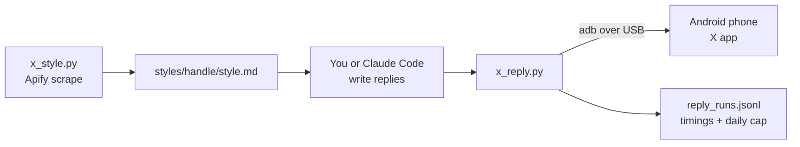

<div align="center">

# x-phone-pilot

**Reply and post on X from your laptop by driving the X app on your own Android phone over USB.**

Paced like a person, checked for AI-sounding text, and able to borrow the reply style of any account.


</div>

---

## What it does

| | |
|---|---|
| 💬 **Reply** | Finds a post on your feed, opens the reply box, types, verifies, sends. About 6 s per reply. |
| 📝 **Post** | Publishes a new post, with line breaks and emoji. |
| 🗓️ **Schedule** | Posts from a queue file at set times. x.com scheduling and an X posting calendar: [coming soon](#coming-soon). |
| ⏱️ **Pace** | Four presets from 25 to 60 replies an hour, with breaks, daily caps and active hours. |
| 🧠 **Learn a style** | Scrapes up to 1,000 replies from any account (about $0.40) and turns them into a style guide. |
| 🧹 **Humanize** | Blocks replies with AI tells, replies that repeat the post, and replies that copy the style source. |

It doesn't use the X API. It taps the real app the way your thumb would, through
[adb](https://developer.android.com/tools/adb), and reads the screen through Android's accessibility tree.



## Contents

- [Requirements](#requirements)
- [Quick start](#quick-start)
- [Commands](#commands)
- [Pacing presets](#pacing-presets)
- [Learn someone's reply style](#learn-someones-reply-style)
- [Humanizer checks](#humanizer-checks)
- [Scheduling posts](#scheduling-posts)
- [Benchmarks](#benchmarks)
- [Safety](#safety)
- [Troubleshooting](#troubleshooting)
- [Coming soon](#coming-soon)

## Requirements

- An Android phone with the X app installed and logged in.
- [Android platform-tools](https://developer.android.com/tools/releases/platform-tools) (`adb`) on your PATH.
- Python 3.10 or newer. Nothing to `pip install`.
- For style learning: an [Apify](https://apify.com) account and API token.

Tested on a Galaxy S22 (1080×2340, Android 16) with Microsoft SwiftKey. Screen positions for the tab bar and
navigation bar are tuned for that size; other phones may need the `SAFE_TOP` / `SAFE_BOTTOM` values adjusted.

## Quick start

**1. Turn on USB debugging.** Settings → About phone → tap *Build number* 7 times. Then Settings → Developer
options → *USB debugging* on.

**2. Connect and authorize.** Plug the phone in, accept the "Allow USB debugging?" prompt, then check:

```bash
adb devices
# R58N123ABCD    device
```

**3. Get the code.**

```bash
git clone https://github.com/Kyrpel/x-phone-pilot.git
cd x-phone-pilot
cp .env.example .env        # add APIFY_TOKEN if you want style learning
```

**4. Keep the screen on while plugged in** (optional, recommended):

```bash
adb shell svc power stayon usb     # undo with: adb shell svc power stayon false
```

**5. Open X on the phone, unlock it, and try a dry run.** It types the reply and checks it, but doesn't send:

```bash
python x_reply.py scan
python x_reply.py reply --handle someone --text "how long did that take you?" --dry-run
```

## Commands

### `x_reply.py`

| Command | What it does |
|---|---|
| `scan [--screens N]` | Lists posts on the next N screens (handle, text, ad or not), then scrolls back. |
| `reply --handle H --text T` | Replies to @H's post on the current screen. `--dry-run` types without sending. |
| `batch FILE [--preset P] [--style H] [--hours 09:00-21:00]` | Replies to a list of posts in feed order. |
| `post --text T` | Publishes a new post. Use `\n` for line breaks. `--dry-run` types, then discards. |
| `schedule FILE [--grace 15]` | Posts each queued item when it's due. |
| `lint TEXT [--post P] [--style H]` | Checks a draft without touching the phone. |

A batch file is a list in feed order. `match` is optional and picks the right post when an account appears twice:

```json
[
  {"handle": "alice_ships", "match": "App Store", "text": "what's the app?"},
  {"handle": "bob_codes", "text": "the noindex one gets everyone at least once"}
]
```

### `x_style.py`

| Command | What it does |
|---|---|
| `fetch --handle H [--max 1000] [--yes]` | Scrapes H's replies with Apify, then builds the style guide. Resumes if run again. |
| `build --handle H` | Rebuilds `styles/H/profile.json` and `styles/H/style.md` from the scraped replies. |

## Pacing presets

People reply in bursts with breaks. Each gap is random inside its range, and the daily cap counts everything
posted today, across runs.

| Preset | Replies / hour | Gap between replies | Break | Daily cap |
|---|---|---|---|---|
| `steady` | 25–30 | 90–150 s | 10 min every 15 | 120 |
| `active` | 35–40 | 60–100 s | 10 min every 20 | 200 |
| `fast` | 45–50 | 50–80 s | 10 min every 25 | 250 |
| `turbo` | ~60 | 40–70 s | 15 min every 30 | 300 |

```bash
python x_reply.py batch batches/today.json --preset steady --hours 09:00-21:00
```

Start with `steady` for a week. Move up only if X has shown no warnings. Every preset stays far below X's
2,400 posts per day, but X's spam detection reacts to patterns well before that limit.

## Learn someone's reply style

Scrape an account's replies, and the tool writes a guide covering their usual length, casing, punctuation,
emoji habits, openers and recurring phrases, with real examples for tone.

```bash
python x_style.py fetch --handle somefounder --max 1000
```

```text
Scraping 1000 more replies by @somefounder (have 0): about $0.40. Spending stops at $0.55.
Continue? [y/N] y
  'from:somefounder filter:replies': 400 returned, 400 new, total 400
  'from:somefounder filter:replies until:2026-10-12': 600 returned, 587 new, total 987
  ...
```

It uses the Apify actor [`apidojo/tweet-scraper`](https://apify.com/apidojo/tweet-scraper) at $0.0004 per
tweet, so 1,000 replies cost about $0.40. A single search reaches back about two weeks for an active account,
so `fetch` pages backwards with `until:` dates and de-duplicates. The spend cap is passed to Apify, which stops
the run there.

What comes out, in `styles/somefounder/style.md` (real output for one account):

```markdown
## Shape
- Length: usually 3 to 12 words, median 6.
- Ends with a period in 2%; asks a question in 7%; uses '!' in 19%.
- Emoji in 24% of replies (2% are emoji only). Most used: 😭 😁 😂 👏 🫶 ❤ 🙏
## Words and openings
- Often opens with: i, yes, so, thank, no, congrats, wow ...
```

The guide sets how a reply sounds, while the post being answered decides what it says. To stop a borrowed style
from turning into copying, `--style` blocks any draft that closely matches one of the scraped replies:

```bash
python x_reply.py lint --style somefounder "<a draft that copies one of their replies>"
# {"ok": false, "problems": ["too close to @somefounder's reply: ..."]}
```

Scraped replies stay on your machine in `styles/` (ignored by git).

## Humanizer checks

Every reply and post goes through a lint based on [blader/humanizer](https://github.com/blader/humanizer),
which is built on Wikipedia's *Signs of AI writing*. A reply is blocked if it has:

- em or en dashes
- stock AI words: *delve, crucial, robust, showcase, game-changer…*
- staged openers: *"Honestly?", "Here's the thing", "Real talk"*
- reply-guy filler: *"great post", "love this", "so true", "this is huge"*
- the not-X-but-Y formula, or ALL CAPS emphasis
- a number or 4+ words repeated from the post
- an emoji within 7 replies of the last one, counted across runs
- apostrophes or quote marks, or contractions typed without them (*whats, dont, im*). Keyboards autocorrect
  those back to *what's*, so rephrase instead: *what would you cut first*

`--force` overrides a block. If you write replies with Claude Code, install the humanizer skill too, and the
included `.claude/skills/x-replies` skill walks Claude through the scan, write, lint and post loop.

## Scheduling posts

```json
[
  {"at": "2026-11-02 09:30", "text": "first line\nsecond line"},
  {"at": "2026-11-02 18:00", "text": "another post"}
]
```

```bash
python x_reply.py schedule my_posts.json
```

The runner writes `posted`, `missed` or `blocked` back into the file. It needs the laptop on, the phone plugged
in and unlocked, and X able to come to the front. If you're typing in another app it waits, and after 15
minutes (`--grace`) it marks the post missed.

> **Coming soon:** scheduling through X's own scheduler on x.com, so X's servers publish your posts and your
> phone and laptop can be off. See [Coming soon](#coming-soon).

## Benchmarks

Measured on a Galaxy S22 over USB, 31 Oct 2026:

| Step | Time |
|---|---|
| Open reply box | 0.4–0.9 s |
| Type a reply (no emoji) | 1.1–1.5 s |
| Verify target and text | 2.6–2.8 s |
| Send | 0.9–1.1 s |
| **Reply total, open to sent** | **5.2–5.9 s** |
| Including finding the post on the feed | 6–22 s |
| A 4-reply batch, end to end | 79 s |
| Typing one emoji (emoji panel) | +16 s |

Almost all of the time is spent reading the screen: `uiautomator dump` takes about 3 s, while an adb tap takes
0.27 s and the keyboard check 0.2 s. Python adds a few milliseconds, so rewriting it in a faster language
wouldn't help. A resident UI server such as [uiautomator2](https://github.com/openatx/uiautomator2) would bring
screen reads down to about 0.3 s.

## Safety

- **Nothing is typed unless X is in front and a reply box has focus.** On the feed, letters are X keyboard
  shortcuts, and in another app they'd land in your chats.
- **The reply target is checked before sending.** If the box doesn't say *Replying to @handle* and the text
  doesn't match, nothing is sent.
- **Only original posts get replies.** When the target is itself someone's reply, X's box says
  *Replying to @a and @b*; the script sees two names, clears the box and moves on.
- **Autocorrect can't sneak in an apostrophe.** If the keyboard changes the text, the reply is cleared, not sent.
- **No half-written replies are left behind.** After any failure the reply box is emptied and closed, and a
  batch never scrolls while a keyboard is open (on SwiftKey a swipe would type a word).
- **The batch stops on sight of X warnings** such as "rate limit", "unusual activity" or "temporarily limited".
- **It can't run in the background on the phone you're using**, because it drives the real screen. Use a
  spare phone or an Android emulator if you want your phone free.

X's [automation rules](https://help.x.com/en/rules-and-policies/x-automation) restrict automated replies, and
accounts that reply at high volume can be limited or suspended. You're responsible for how you use this. Start
slowly, keep a person reviewing what gets posted, and use it on your own account only.

## Troubleshooting

| Problem | Fix |
|---|---|
| `adb devices` shows `unauthorized` | Unlock the phone and accept the USB debugging prompt. |
| Emoji not typed | `adb shell input text` can't send emoji, so the script taps them in the keyboard's emoji panel. That works with SwiftKey, which labels each emoji; other keyboards may not. |
| Words change after typing | Your keyboard's autocorrect. A capital first letter is accepted; any other change, including an added apostrophe, stops the reply. Rephrase the draft. |
| `is a reply in a conversation` | The post you picked is someone's reply. Pick the original post at the top of the thread. |
| A tap lands on the nav bar | Adjust `SAFE_TOP` / `SAFE_BOTTOM` in `x_reply.py` for your screen. |
| `X is not the app in front` | Bring X to the front and don't use the phone during a batch. |
| Style fetch returns fewer replies | The account may not have that many in reach of search. Run `fetch` again later; it resumes. |

## Project layout

```text
x_reply.py               phone control: scan, reply, batch, post, schedule, lint
x_style.py               Apify scrape + style guide builder
.claude/skills/x-replies Claude Code skill for the reply workflow
styles/<handle>/         scraped replies, profile.json, style.md   (git-ignored)
batches/                 reply lists you've run                    (git-ignored)
reply_runs.jsonl         per-step timings and the daily cap log    (git-ignored)
```

## Coming soon

- **Scheduling on x.com.** Queue posts in a file and have them entered into X's own scheduler, so they go out
  from X's servers even when your phone and laptop are off.
- **A posting calendar for X.** Plan, review and queue your X posts in one self-hosted calendar.

Want one of these sooner, or something else? Open an issue.

## License

MIT. See [LICENSE](LICENSE).
